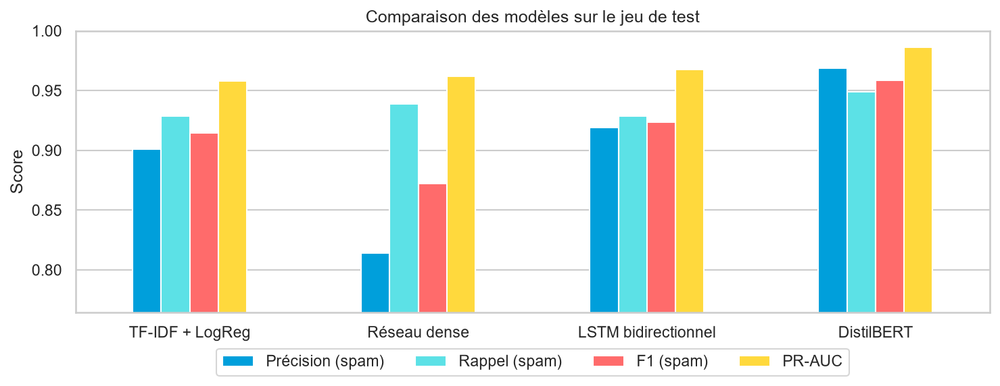
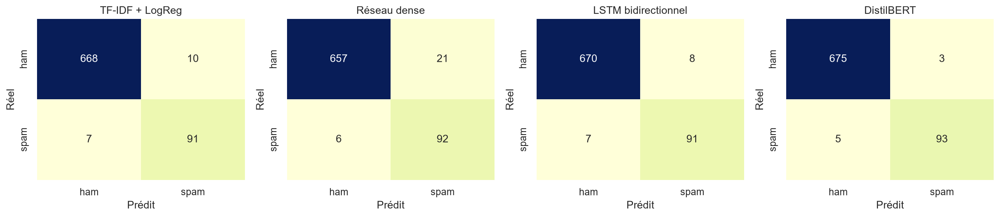
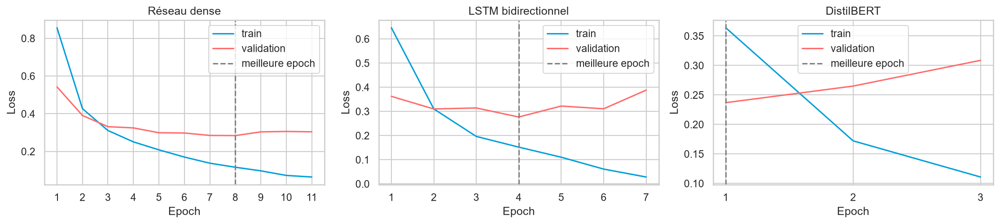

# Détecteur de spams SMS — AT&T

Certification CDSD RNCP35288 - Bloc 4 : Analyse prédictive de données non-structurées par l'intelligence artificielle

## Contexte

AT&T est une société américaine qui cherche à automatiser la détection de spams parmi des messages et ainsi mieux protéger ses utilisateurs. 
Actuellement, l'identification des spams est manuelle.  

## Objectifs

Construire un détecteur de spam capable de déterminer automatiquement, à partir du seul contenu d'un sms, si un message est un spam ou non.

## Données

- **Source** : https://full-stack-bigdata-datasets.s3.eu-west-3.amazonaws.com/Deep+Learning/project/spam.csv
- **Contenu** : `data/spam.csv`, 5 572 SMS en anglais étiquetés `ham` (légitime) ou `spam`. Le fichier est encodé en `latin-1` et contient trois colonnes parasites (presque vides) ignorées : seuls l'étiquette (`v1`) et le texte (`v2`) sont conservés.
- **Contrôle qualité** : 403 messages sont des doublons exacts. Ils sont supprimés avant tout découpage, sinon un même message pourrait se retrouver dans le train **et** dans le test et gonfler artificiellement les scores. Il reste **5 169 SMS** dont **653 spams (12,6 %)**.
- **Découpage stratifié** 70 / 15 / 15 :

| Jeu | SMS | Spams |
|---|---|---|
| Entraînement | 3 617 | 457 |
| Validation | 776 | 98 |
| Test | 776 | 98 |

Le jeu de validation sert à l'arrêt anticipé et au choix du meilleur modèle ; le jeu de test n'est jamais utilisé pour choisir ou régler un modèle : il sert uniquement à annoncer les performances finales.

## Etapes du projet 
1. Imports et configuration
2. Exploration et préparation des données
3. Baseline : TF-IDF + régression logistique
4. Réseaux de neurones
5. Comparaison des modèles
6. Analyse des erreurs
7. Démonstration d'inférence
8. Sauvegarde des résultats

## Méthodologie
1. Charger les données, **contrôler leur qualité** (doublons) et les explorer.
2. Transformer le texte en matrices exploitables par un réseau de neurones.
3. Découper en **trois jeux** : entraînement, validation (pour régler et
   arrêter l'entraînement), test (évaluation finale, jamais utilisé avant).
4. Comparer quatre modèles, du plus simple au plus sophistiqué :
   - **TF-IDF + régression logistique** : baseline non neuronale ;
   - **réseau dense** (perceptron multicouche) sur embeddings moyennés ;
   - **LSTM bidirectionnel** (réseau récurrent) ;
   - **DistilBERT** pré-entraîné, affiné par *transfer learning*.
5. Évaluer sur train / validation / test, analyser les erreurs, conclure.

## Résultats

Jeu de test (776 SMS dont 98 spams), `SEED = 42`, exécution sur CPU.

| Modèle | Précision | Rappel | F1 | PR-AUC | Erreurs (FP + FN) | ms / message (CPU) |
|---|---|---|---|---|---|---|
| TF-IDF + LogReg | 0,901 | 0,929 | 0,915 | 0,958 | 17 (10 + 7) | 0,024 |
| Réseau dense | 0,814 | 0,939 | 0,872 | 0,962 | 27 (21 + 6) | 0,016 |
| LSTM bidirectionnel | 0,919 | 0,929 | 0,924 | 0,968 | 15 (8 + 7) | 0,219 |
| **DistilBERT** | **0,969** | **0,949** | **0,959** | **0,986** | **8 (3 + 5)** | 20,2 |

Les temps d'inférence sont indicatifs : ils varient d'une exécution à l'autre et, pour les réseaux de neurones, ne comprennent pas la tokenisation.







### Interprétations

- **DistilBERT est le meilleur modèle** sur la validation comme sur le test : 93 spams détectés sur 98 et seulement 3 messages légitimes bloqués à tort. Il est aussi le seul à repérer un SMS de livraison frauduleux absent du style du corpus (score 0,98 contre 0,02 à 0,43 pour les autres modèles) — un exemple illustratif, pas une preuve.
- **La baseline est très solide** : son F1 (0,915) est à 2 messages de celui du LSTM (0,924). Le deep learning se juge sur ce qu'il apporte en plus, et à quel coût.
- **Surapprentissage** : l'écart de F1 entre train et validation est de 0,04 à 0,06 pour la baseline, le réseau dense et le LSTM, et de 0,02 pour DistilBERT. Sa loss de validation remonte à partir de la 2e epoch ; la 1re est la meilleure et ses poids sont conservés.
- **Coût** : DistilBERT est environ 840 fois plus lent que la baseline à l'inférence sur CPU (≈ 5,6 h de calcul sur un cœur pour 1 million de messages, contre ≈ 24 s), ce qui impose un GPU ou un compromis en production.
- **Erreurs de DistilBERT** : les 5 spams manqués ont des scores très bas (< 0,02) et n'ont pas les marqueurs habituels (annonce humoristique, sonneries, jeu-concours) ; les 3 faux positifs (scores 0,55 à 0,87) ressemblent à de la publicité.

### Limites

- **Peu de spams dans le test (98)** : les intervalles de confiance à 95 % du rappel (≈ [89 %, 98 %] pour DistilBERT, [86 %, 97 %] pour la baseline) se recouvrent. La supériorité de DistilBERT est plus marquée sur la précision, mais pas démontrée sur le rappel.
- **Un seul découpage et une seule graine** : une validation croisée quantifierait l'incertitude.
- **Corpus ancien et en anglais** : les spams actuels (hameçonnage par SMS, par exemple) diffèrent de ceux du corpus.

### Perspectives

- Ajuster le **seuil de décision** selon le coût relatif d'un faux positif (SMS légitime bloqué) et d'un faux négatif (spam reçu), à partir de la courbe précision-rappel.
- **Augmenter la classe spam** avec des données synthétiques (réseaux génératifs adverses, modèles de langage).
- **Surveiller la dérive** des messages en production et ré-entraîner régulièrement ; étendre à d'autres langues.

## Structure du dépôt

```
cdsd_bloc4_projet_at_t_spam_detection/
├── assets/
│   └── images/ 
├── data/
│   └── spam.csv 
├── notebooks/
│   └── spam_detector.ipynb 
├── results/
│   └── metrics.json 
├── .gitignore
├── README.md
└── requirements.txt
```

## Installation et exécution

```powershell
conda create -n cdsd_b4_att_spam_detector python=3.11.15 pip -y
conda activate cdsd_b4_att_spam_detector
python -m pip install -r requirements.txt  
```

## Crédits

- Modèle pré-entraîné : `distilbert-base-uncased` (Hugging Face).
- Bibliothèques : PyTorch, Transformers, scikit-learn, pandas, matplotlib, seaborn.


